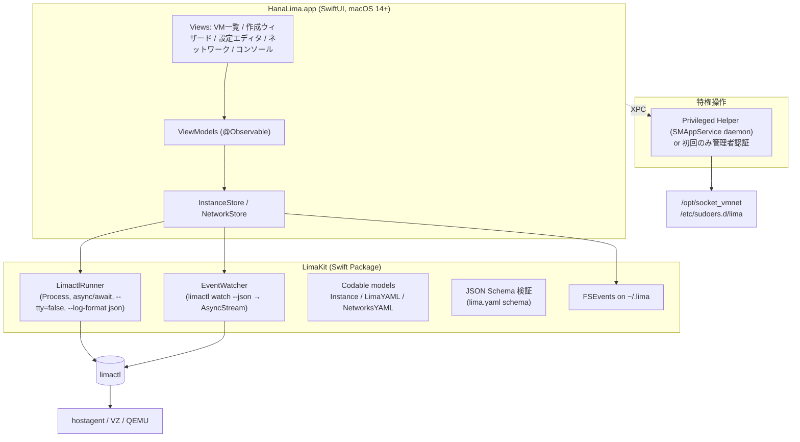

# HanaLima：既存ソフト調査とアーキテクチャ案

調査日: 2026-10-09（Lima 最新安定版は v2.2.1、v2.3.0-beta.1）

## 1. 結論（要約）

- **Lima 公式の GUI はない。** サードパーティの GUI も、GUI だけで VM の作成・リソース割り当て・仮想ネットワーク構築まで扱えるものは見つからなかった。
- 既存のものは、**起動・停止だけのメニューバーツール**か、**コンテナ用途に特化した Lima ラッパー**のどちらか。
- 「GUI だけで VM もネットワークも組める Lima 管理アプリ」には明確な空白がある。作る価値はある。
- 推奨構成は **SwiftUI ネイティブアプリ＋`limactl` CLI をラップする Swift パッケージ**。Lima の Go コードは直接リンクしない。
  - `limactl list --format json` と `limactl watch --json`（v2.1 以降）で状態を取得・監視する。
  - `lima.yaml` は v2.3 から公開される JSON Schema で検証する。

## 2. 既存ソフト調査

### 2.1 Lima 専用の GUI

| ソフト | 形態 / 言語 | できること | できないこと | 状況 |
|---|---|---|---|---|
| [lima-gui](https://github.com/afbjorklund/lima-gui)（Lima メンテナの afbjorklund 作） | Qt / C++、システムトレイ＋ウィンドウ | インスタンスの作成・削除、起動・停止、ターミナル（QTermWidget）、VNC | ネットワーク構築、詳細なリソース編集。主に Linux 向けで、macOS のバイナリ配布やリリースはない | ★245、2026-08 に更新。実験的 |
| [Limac](https://github.com/ahmetb/limac) | Swift、メニューバー専用（macOS 14 以降、Lima 2.0 以降） | 起動・停止・再起動、ターミナル起動、kubeconfig、ログイン時の自動起動 | **VM の作成をしない**（README に明記）。ネットワーク管理もない | ★49、2026-08 に更新。未署名 |
| [lima-xbar-plugin](https://github.com/unixorn/lima-xbar-plugin) | Python、xbar / SwiftBar プラグイン | 起動・停止、コンテナやイメージの操作 | 作成、設定編集、ネットワーク | ★145、活発 |
| Podman Desktop の Lima 拡張 | Electron | コンテナ用 Lima インスタンスの作成・管理 | 汎用 VM 管理（コンテナ用途が前提） | — |

### 2.2 Lima を内部で使うが、汎用 VM 管理ではないもの
- **Rancher Desktop**：Kubernetes とコンテナ向け。VM は内部実装として隠されている。
- **Colima**：CLI のみ。Docker と K8s 向け。
- **Finch**（AWS）：CLI のみ。コンテナ向け。

### 2.3 Lima 以外のデスクトップ仮想化 GUI（比較対象）
- **商用のデスクトップ仮想化ソフト**：完成された GUI だが、プロプライエタリ。
- **UTM**：QEMU と Virtualization.framework 向けの GUI。macOS 26 の `VZVmnetNetworkDeviceAttachment` を使い、**root 不要の VM 間ネットワークと host-only ネットワーク**に対応する PR が進んでいる。
- **VirtualBuddy**：macOS ゲスト専用。**Tart**：CLI のみ（CI 向け）。**OrbStack**：Linux マシン機能があるが、ネットワークを細かく設計する用途には向かない。

> HanaLima の差別化ポイント：cloud-init ベースのテンプレートで数十秒で起動できること、ホストのディレクトリ共有、ポートの自動フォワード、`limactl shell`、プロビジョンスクリプト。これらは Lima の強みで、UTM や商用ソフトにはない。そこへ GUI による「見える化」と「ネットワーク設計」を被せる。

## 3. Lima 側の機能（GUI がラップする対象）

| 仮想化ソフトの一般的な概念 | Lima での実現手段 |
|---|---|
| 仮想 CPU、メモリ | `cpus`、`memory`（`limactl create/edit --cpus --memory`）。編集は停止中のみ |
| 起動ディスク | `disk`（デフォルトは 100GiB、sparse） |
| 追加ディスク | `limactl disk create/resize/delete/list` と `additionalDisks:`。v2.3 で mountPoint 指定、VZ でのホスト側ブロックデバイス接続（`--block-device`）に対応 |
| NAT | (a) デフォルトの user-mode（192.168.5.0/24 固定。ホストからゲスト IP へは届かない）、(b) **vzNAT**（VZ 専用、root 不要、高速だがサブネットは指定不可）、(c) **socket_vmnet の `shared`** |
| Host-only | socket_vmnet の `host` |
| ブリッジ | socket_vmnet の `bridged`（`interface: en0` など。DHCP は外部ネットワーク任せ） |
| VM 間ネットワーク | `user-v2`（gvisor-tap-vsock）、または socket_vmnet |
| 名前付き仮想ネットワーク | `~/.lima/_config/networks.yaml` を編集、または `limactl network create NAME --gateway x.x.x.1/24` |
| NIC の割り当て | インスタンスの `networks:` リストに `- lima: shared`、`- vzNAT: true`、`- socket: ...` を並べる（MAC アドレスとインターフェース名も指定可） |
| コンソールと画面 | `video.display`（VZ の GUI ウィンドウ）、`limactl shell`、`limactl screenshot`（v2.2 以降） |
| 状態監視 | `limactl list --format json`、**`limactl watch --json`**（v2.1 以降、NDJSON のイベントストリーム） |
| 自動起動 | `limactl autostart enable [--keep-alive]`、LaunchDaemon（v2.2 以降） |
| 設定の検証 | **`lima.yaml` の JSON Schema**（v2.3 でリリース成果物に追加） |
| ゲスト OS | Linux 各種のテンプレート、macOS（v2.1 以降）、FreeBSD、Windows（実験的） |

**ネットワークの制約（GUI の設計で最も重要）**
- socket_vmnet は **root 所有のパス（`/opt/socket_vmnet`）へのインストール**と **sudoers の設定（`limactl sudoers`）**が必要。Homebrew 版は拒否される。v2.2 以降は `admin` グループのみ利用できる。
- vzNAT は root 不要だが、サブネットの指定も VM 間の固定 IP も扱えない。
- macOS 26 の `VZVmnetNetworkDeviceAttachment`（vmnet_network を使い、root 不要でカスタムサブネットの NAT や host-only を作れる）は、**Lima ではまだ採用されていない**。Go バインディング（Code-Hex/vz #218）は存在する。→ 将来的に Lima 本体へ貢献する余地がある。

## 4. アーキテクチャ案

### 4.1 選択肢の比較

| 案 | 構成 | 長所 | 短所 |
|---|---|---|---|
| **A（推奨）** | SwiftUI アプリ → `limactl` をサブプロセスとして呼ぶ | CLI は Lima の公式インターフェースで、互換性が最も保たれる。ネイティブの見た目、署名・公証、メニューバー、SMAppService が使える | CLI 出力への依存（JSON があるので実用上は十分） |
| B | Go のデーモン（Lima の `pkg/` をライブラリとしてリンク）＋ Swift UI を gRPC でつなぐ | 内部状態に直接触れる | Lima の Go API は安定 API ではなく、追従コストが大きい。二言語になる |
| C | Tauri / Electron | クロスプラットフォーム（Lima は Linux / Windows ホストもある） | macOS 固有の機能（特権ヘルパー、メニューバー、VZ ウィンドウ）との統合が弱い |

→ macOS 専用で「GUI だけで完結する体験」を目指すなら **A**。Limac も同じ方針で、実績がある。

### 4.2 推奨構成（案 A）

**レイヤーの責務**
1. **LimaKit（Swift Package、UI 非依存でテストしやすい）**
   - `LimactlRunner`：`limactl` を探す（同梱版 → Homebrew 版 → PATH の順）、バージョンを確認する（最低 v2.1）。`--tty=false --log-format json` で実行し、stderr の JSON ログを進捗として流す。
   - `EventWatcher`：`limactl watch --json` を常駐させ、`AsyncStream<LimaEvent>` として配信する。プロセスが落ちたら再起動する。`limactl list --json` の定期ポーリングとの二重化でもよい。
   - モデル：`lima.yaml` と `networks.yaml` を Codable（＋ Yams）で読み書きする。**未知のキーを失わないように**、GUI が扱うキーだけ差分を当てる方式にする（`limactl edit --set '.cpus=4'` を使うのが最も安全）。
2. **アプリ（SwiftUI）**
   - サイドバーに VM 一覧（状態バッジ、CPU / メモリ / IP、`limactl screenshot` のサムネイル）。
   - **作成ウィザード**：テンプレートの選択（`limactl create --list-templates`）→ CPU / メモリ / ディスク → NIC（追加・削除）→ マウント → ポートフォワード → 確認画面（生成される YAML を表示）。
   - **設定エディタ**：フォームと YAML の 2 タブ。JSON Schema でリアルタイムに検証する。
   - **ネットワーク管理画面**：`networks.yaml` の一覧と編集（shared / host / bridged、ゲートウェイ、DHCP 範囲、ブリッジ先 NIC）。どの VM がどのネットワークを使っているかを図示する。
   - **コンソール**：SwiftTerm で `limactl shell` を埋め込む。グラフィカルなゲストは `video.display: vz` のウィンドウを使う。
   - メニューバー（`MenuBarExtra`）での起動・停止と自動起動の設定。
3. **特権操作**
   - socket_vmnet のインストールと `limactl sudoers` の配置を「ネットワーク機能を有効化」ウィザードにまとめ、**一度だけ**管理者認証をする。
   - MVP では `osascript ... with administrator privileges`、正式版では `SMAppService.daemon` ＋ XPC の特権ヘルパーを使う。
   - 日常の操作（VM の起動など）では root を要求しない。

### 4.3 配布
- Developer ID で署名・公証し、Sparkle で更新する。
- `limactl` は **固定バージョンを同梱**するか、Homebrew 版を使うかを選べるようにする。デフォルトは同梱にして、バージョンのずれを防ぐ。
- socket_vmnet は root 所有のパスが必須なので、同梱版をヘルパー経由で `/opt/socket_vmnet` へ展開する。

## 5. 段階的ロードマップ

| フェーズ | 内容 |
|---|---|
| **MVP** | VM 一覧と状態監視（watch）、起動・停止・削除、テンプレートからの作成（CPU / メモリ / ディスク / vzNAT）、シェルの埋め込み、YAML の閲覧 |
| v0.2 | 設定編集（フォームと YAML、Schema 検証）、追加ディスク（`limactl disk`）、マウント、ポートフォワード、メニューバー、自動起動 |
| v0.3 | socket_vmnet のセットアップウィザード、ネットワーク管理（shared / host / bridged の作成・編集）、NIC の複数割り当て、ネットワーク構成図 |
| v0.4 | スナップショット（QEMU のみ）、`limactl screenshot` のサムネイル、ログビューア、プロビジョンスクリプトの編集 |
| 将来 | macOS 26 の vmnet（root 不要のカスタムサブネット）を Lima 本体へ PR するか、Lima 2.x のドライバプラグインとして提供し、GUI から使う |

## 6. 未確定事項と次のアクション
1. `limactl watch --json` のイベントスキーマは文書化されていない → 実機で出力を採取して確認する（ローカルには Lima が未インストール）。
2. `limactl network create` の正確なフラグと、`networks.yaml` の変更が起動中の VM に与える影響を確認する。
3. 対応する macOS の下限：14（Limac と同じ）にするか、vmnet の新 API を使う 26 にするか。
4. 同梱する `limactl` のライセンス（Apache-2.0）と、更新の運用。

## 参考
- Lima: https://github.com/lima-vm/lima / コミュニティ: https://lima-vm.io/community
- VMNet ネットワーク: https://lima-vm.io/docs/config/network/vmnet/
- limactl watch: https://lima-vm.io/docs/reference/limactl_watch/ / list: https://lima-vm.io/docs/reference/limactl_list/ / disk: https://lima-vm.io/docs/reference/limactl_disk_create/
- lima-gui: https://github.com/afbjorklund/lima-gui / Limac: https://github.com/ahmetb/limac / xbar: https://github.com/unixorn/lima-xbar-plugin
- UTM の vmnet 対応 PR: https://github.com/utmapp/UTM/pull/7865 / Code-Hex/vz の VZVmnetNetworkDeviceAttachment: https://github.com/Code-Hex/vz/pull/218
