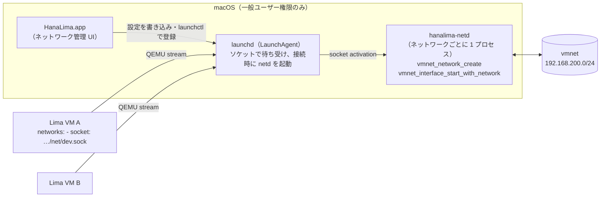

# ネットワーク機能（v0.3）調査結果と設計案

調査日: 2026-10-09 / 環境: macOS 27.0.1 (Apple Silicon), Lima 2.2.1, Xcode 27

## 1. 結論

**macOS 26 の新しい vmnet API を使えば、root も socket_vmnet も不要で、サブネットを指定した NAT / ホストオンリーネットワークを HanaLima 自身が提供できる。Lima 本体の改修も不要。**

HanaLima に小さな常駐ヘルパー（以下 `hanalima-netd`）を同梱する。netd は socket_vmnet と同じプロトコルで UNIX ソケットを待ち受け、Lima の `networks: - socket: <path>` から接続を受ける。netd の中身は socket_vmnet と違い、root 不要な macOS 26 の `vmnet_network_*` API を使う。

ブリッジ接続だけは新 API が対応していないため、従来どおり socket_vmnet（root）が必要。

## 2. 検証したこと

試作コード: [Prototypes/vmnet-relay](../Prototypes/vmnet-relay)

| 項目 | 結果 |
|---|---|
| 一般ユーザー権限での `vmnet_network_create` | ad-hoc 署名のみでは `1002` で失敗。**`com.apple.security.virtualization` エンタイトルメント付きで ad-hoc 署名すれば成功**（制限付きエンタイトルメントではない） |
| サブネット指定 | 成功。ただし `set_ipv4_subnet` に渡すアドレスはネットワークアドレス（.0）ではなく**ゲートウェイ（ホスト側）アドレス（.1）**。.0 を渡すと作成は成功するがインターフェース開始が `1001` で失敗する |
| shared / host モード | どちらも成功 |
| 1 つのネットワークに複数インターフェース | 成功（VM ごとに 1 インターフェース） |
| Lima VM（VZ, Alpine）からの接続 | `networks: - socket: ~/Library/Application Support/HanaLima/net/poc.sock` で接続。ゲストの `lima0` に DHCP で 192.168.200.2/24 が割り当てられた |
| ホスト → ゲスト | TCP 22 番に接続成功（ホストからの ping はコマンド実行環境の制約で未確認） |
| ゲスト → ホスト（192.168.200.1） | ping 成功 |
| ゲスト → インターネット（lima0 経由の NAT） | ping 成功（1.1.1.1、約 10ms） |
| VM ↔ VM（2 台目 192.168.200.3） | 双方向 ping 成功 |

### Lima 側の仕組み（v2.2.1 のソースで確認）
- `networks: - socket: PATH` は VZ・QEMU とも対応。VZ ドライバは UNIX ストリームソケットに接続し（`DialQemu`）、ソケットペアを介して `VZFileHandleNetworkDeviceAttachment` に中継する。
- フレーミングは QEMU stream 形式：各フレームの前に **4 バイトのビッグエンディアン長**。socket_vmnet と同じ。
- ゲスト内では追加 NIC が `lima0`, `lima1`… として DHCP 設定される。

## 3. 設計案

- **ヘルパー**: `hanalima-netd`（Swift の実行ファイル、`com.apple.security.virtualization` 付きで署名）。`HanaLima.app/Contents/Helpers/` に同梱する。
- **起動方法**: ネットワークごとに `~/Library/LaunchAgents/org.izawa.HanaLima.net.<name>.plist` を生成し、`launchctl bootstrap gui/<uid>` で登録する。launchd の **Sockets（ソケットアクティベーション）** でソケットを待ち受けさせ、最初の接続で netd を起動する。
  - こうすると、HanaLima.app を閉じても、ターミナルから `limactl start` しても、ネットワークが使える（アプリがネットワークを抱えていると、アプリ終了で VM の通信が切れてしまう）。
- **設定**: `~/Library/Application Support/HanaLima/networks.json`（名前、モード、ゲートウェイ、ネットマスク、DHCP 予約など）。ソケットは `~/Library/Application Support/HanaLima/net/<name>.sock`（UNIX ソケットのパス長上限 104 バイトに収まる）。
- **VM からの参照**: lima.yaml には `socket:` の絶対パスとして書く。UI では「hanalima:<name>」として表示し、ネットワーク一覧から選べるようにする。
- **UI**: サイドバー「ネットワーク」→ 仮想ネットワークエディタ（デスクトップ仮想化ソフトによくある GUI のネットワーク設定画面）。作成・編集・削除、接続中の VM と IP の一覧。

### 実装状況（2026-10-09）
- 上記の設計どおり実装済み（`Sources/NetworkKit`, `Sources/hanalima-netd`, アプリの「仮想ネットワーク」画面）。
- launchd のソケットアクティベーションは `launch_activate_socket` を `dlsym` 経由で呼び出して動作確認済み。
- `NetworkEndToEndTests` で、LaunchAgent 登録 → VM 起動時にヘルパーが起動 → DHCP で指定サブネットのアドレスが付く → ゲートウェイへ到達、までを確認。

### 未確定・要検証
1. ~~launchd のソケットアクティベーションで渡されたソケットを netd が受け取れるか~~ → 確認済み。
2. ~~DHCP 予約で VM ごとに固定 IP を割り当てられるか~~ → 対応済み（下記）。

### DHCP 予約（固定 IP）の調査結果（2026-10-09）
- `vmnet_network_configuration_add_dhcp_reservation` はゲスト NIC の MAC アドレスで予約する。
- しかし vmnet の DHCP サーバー（bootpd、リースは `/var/db/dhcpd_leases`）は、クライアントが DHCP オプション 61（クライアント識別子）を送るとそれでクライアントを識別する。Alpine の dhcpcd をはじめ、現在の多くの Linux は RFC 4361 の DUID ベースの識別子を既定で送るため、**MAC での予約が一致しない**（実測: 予約しても .2 が割り当てられた）。
- ゲストの dhcpcd を `clientid`（MAC ベース）に変えると予約どおり .50 が割り当てられることを確認。
- 対策として、hanalima-netd が **予約のある MAC からの DHCP 要求に限りオプション 61 を取り除く**（`DHCPClientIDFilter`）。bootpd はハードウェアアドレスで識別するようになり、ゲスト OS の設定に関係なく予約が効く。既定設定の Alpine で .50 が割り当てられることを E2E テストで確認。
- 応答には識別子が付かなくなるが、RFC 6842 は受け取った識別子を返すことしか求めておらず、dhcpcd は受け入れた。Ubuntu（systemd-networkd）などは未検証。
3. スループット（iperf3 で socket_vmnet・vzNAT と比較）。
4. ネットワーク設定変更時の挙動（接続中の VM がある場合は再起動が必要、など）。
5. ブリッジ接続: 新 API 非対応。socket_vmnet のセットアップ画面（初回のみ管理者認証）として実装済み（`SocketVMNetSetup`）。

## 参考
- macOS SDK `vmnet.framework/Headers/vmnet.h`（`vmnet_network_configuration_create`, `vmnet_network_create`, `vmnet_network_copy_serialization`, `vmnet_interface_start_with_network` ほか、すべて `API_AVAILABLE(macos(26.0))`）
- Lima `pkg/driver/vz/vm_darwin.go`, `pkg/driver/vz/network_darwin.go`（v2.2.1）
- [nirs/vmnet-helper](https://github.com/nirs/vmnet-helper)（macOS 26 以降は root 不要との記載）
- [Code-Hex/vz #218](https://github.com/Code-Hex/vz/pull/218)、[UTM #7865](https://github.com/utmapp/UTM/pull/7865)

## 既知の制約: 仮想ネットワークとブリッジの同時使用（2026-10-09, macOS 27.0.1）

> Apple に報告済み: **FB25122122**（[docs/feedback/vmnet-bridge100-conflict.md](feedback/vmnet-bridge100-conflict.md)）。Lima なしの最小再現では、新規作成同士はどちらの順でも共存し、**インターフェースを止めた vmnet_network を再利用したとき**にだけ衝突する（bridge100 を奪い、en0 を外し、ホストの IPv4 が消える）ことを確認した。

HanaLima の仮想ネットワーク（macOS 26 の rootless `vmnet_network`）と、socket_vmnet のブリッジ（従来の `vmnet_start_interface` + `VMNET_BRIDGED_MODE`）を同時に使うと、どちらも `bridge100` を使おうとして衝突する。**後から作られた側が `bridge100` を取り、先にあった側が壊れる。**

観察した事実（同じ VM に demo NIC と lima:bridged NIC を付けた状態）:

| 順序 | 結果 |
|---|---|
| demo のネットワークが先（ログイン時に作成）→ VM 起動で socket_vmnet が bridged を開始 | bridged が `bridge100` に `en0` と共に入り成功。demo はインターフェース開始が `1001` で失敗 |
| bridged が動作中 → VM 再起動で demo のネットワークを新規作成 | demo が `bridge100`（192.168.200.1）を取り成功。`en0` が `bridge100` から外れ、bridged の DHCP が届かなくなる |
| 再起動前（どちらが先かは不明） | demo は成功、bridged の `vmenet0` は DOWN のまま |

- 単独ではどちらも動作する（ブリッジ: LAN の DHCP から 192.168.100.13 を取得、demo: 予約どおり 192.168.200.10）。
- hanalima-netd は、ネットワークを最初の接続時に作り、失敗時は作り直すようにした（`f00392c`）。これで demo 側の失敗は減るが、ブリッジ側が壊されるのは macOS 内部の問題で、HanaLima 側の順序制御では避けられない。

### 原因の特定と対策（2026-10-09 追記）
- **予約が 2 回目の起動で消える**: [Apple Developer Forums thread 847642](https://developer.apple.com/forums/thread/847642)（FB24895271）と同じ。`vmnet_network_ref` を保持していても、最後のインターフェースが止まるとネットワークがアイドルに戻り、DHCP 予約とポートフォワード規則が消える。
- **ブリッジ番号の衝突**: [apple/container#2051](https://github.com/apple/container/issues/2051)。ネットワークのブリッジ番号（bridge100, 101, …）は最初の起動時に「その時点で空いている最小番号」に決まり、オブジェクトが生きている間は変わらない。別のネットワークのブリッジが一時的に消えていると同じ番号を共有してしまい、片方が終わるともう片方の通信が壊れる。従来 API（socket_vmnet）の bridge100 も考慮されないとみられる。
- **対策（hanalima-netd）**: ネットワークは最初の VM 接続時に作り、最後の VM が切断したら解放する。次の接続で設定から作り直すので、予約が復元され、ブリッジ番号もその時点で空いている番号になる。E2E で 2 回目の起動でも予約どおり .50 になることを確認（解放から再作成まで約 1 秒、1001 は発生せず）。
- **対策（アプリ）**: socket_vmnet のネットワーク（lima:shared/host/bridged）と HanaLima の仮想ネットワークを同時に使う起動を拒否する（`NetworkConflict`）。従来 API との衝突は HanaLima 側では避けられないため。ブリッジとの衝突では Mac 本体の en0 から IPv4 アドレスが外れることも確認した（再起動で回復）。

### 同時使用の実機検証（2026-10-09, `e105f0c` 以降の netd）
VM 2 台（demo の NIC だけの VM、lima:bridged の NIC だけの VM）と、両方の NIC を持つ VM 1 台で、次の 6 パターンを実行した。すべて、各 VM のアドレス（demo は予約どおり .10、ブリッジは LAN の DHCP）が付き、Mac の en0 の IPv4 も維持された。

| # | 操作 | ブリッジ番号の割り当て |
|---|---|---|
| 1 | demo の VM を起動 → bridged の VM を起動 | 100 = demo, 101 = bridged + en0 |
| 2 | bridged を動かしたまま demo の VM を再起動 | demo は解放され、作り直されて空いている 100 に入る |
| 3 | demo を動かしたまま bridged の VM を再起動 | bridged が 101 に作り直される |
| 4 | 両方停止 → bridged を先に起動 → demo を起動 | 100 = bridged + en0, 101 = demo |
| 5 | 4 の状態で demo の VM を再起動 | demo は新しく作られ、101 に入る |
| 6 | 1 台の VM に両方の NIC を付け、3 回連続で起動・再起動 | 100 = bridged + en0, 101 = demo |

→ アプリは起動を拒否するのをやめ、確認ダイアログで警告したうえで起動できるようにした。

## root 不要のブリッジ（2026-10-09、macOS 27.0.1）

`Prototypes/vmnet-bridge-relay`: Lima の `socket:` ネットワークを、従来 API のブリッジ（`vmnet_start_interface` + `VMNET_BRIDGED_MODE`、en0）に中継する。VM の接続ごとにインターフェースを 1 つ作る。`com.apple.security.virtualization` 付きの ad-hoc 署名で、**一般ユーザー（uid 501）のまま**動かした。ほかの vmnet 利用者（socket_vmnet、netd の VM）はいない状態で試した。

| 確認項目 | 結果 |
|---|---|
| `vmnet_start_interface`（root なし） | 1000（成功）。vmnet の MAC は起動のたびに変わる。MTU 1500、最大パケット 1514 |
| ブリッジ | `bridge100` のメンバーは `vmenet0` と `en0`。en0 の IPv4（192.168.100.4）は維持された |
| VM の DHCP | `lima0` に LAN の DHCP から 192.168.100.31 が割り当てられた（2 回目の起動でも同じ） |
| VM → ルーター、VM → インターネット | 成功（インターネットは `lima0` 経由の経路を指定したとき。既定経路は `eth0` 側が優先される） |
| Mac → VM | ping 成功。ARP は en0 上で VM の MAC（52:55:55:…）として学習された |
| VM の MAC | vmnet の MAC とは異なる VM の MAC のまま通信できた（ブリッジモードは送信元 MAC を書き換えも制限もしない） |
| 終了 | VM 停止でインターフェースを止め（1000）、SIGINT で終了したあと、bridge1xx は消え、en0 の IPv4 は維持された |
| 繰り返し | 2 回目の中継起動・VM 起動でも同じ結果 |

### 2 台同時と、HanaLima の仮想ネットワークとの同時使用

| 確認項目 | 結果 |
|---|---|
| 2 台の VM を同時にブリッジ（VM ごとにインターフェース） | `bridge100` のメンバーは en0、`vmenet0`、`vmenet1`。VM は .32 と .33 を取得。Mac↔各 VM、VM↔VM、VM→ルーターすべて成功 |
| 片方の VM を停止 | その VM の `vmenet` だけが外れ、もう片方は通信を続けた |
| 1 台の VM に `demo`（netd）とブリッジの NIC | `bridge100`＝ブリッジ（en0 ＋ 2 台分）、`bridge101`＝`demo`（192.168.200.1）に分かれた。`lima0` は 192.168.200.7、`lima1` は 192.168.100.34。両方の NIC で Mac・ルーターと通信できた |
| その VM を再起動（netd が `demo` を解放して作り直す。ブリッジは動いたまま） | 同じ構成に戻り、すべて通信できた |
| 全体を通して | en0 の IPv4 は一度も消えなかった。終了後は bridge1xx が消えた |

結論: VM ごとに従来 API のブリッジインターフェースを作る方式で、root なしのブリッジを提供できる。netd がネットワークを使い回さない限り、HanaLima の仮想ネットワークとも共存する。未確認: Wi-Fi（en1 など）でのブリッジ。

### アプリでの確認で見つかった 2 つの問題（2026-10-09）

hanalima-dev に `demo`（NAT、固定 IP）と `lan`（netd のブリッジ）の 2 つの NIC を付けて起動した。

1. **`demo` の作成が 1001 で失敗し続けた。** 2 つの NIC が同じ秒に接続し、`vmnet_network_create` と `vmnet_start_interface`（ブリッジ）が重なった。そのプロセスでは、その後 6 分以上、2 秒おきの再試行がすべて 1001 になった。VM を再起動しても同じだった。
   - 同じ時点で、別のプロセスから別のサブネット（10.252.182.0/24）を作ると成功した。
   - netd を SIGTERM で終了させ、新しいプロセスにすると、同じく 2 つの NIC が同時に接続したのに、192.168.200.0/24 をすぐに作成でき、固定 IP の 192.168.200.10 も割り当てられた。
   - → 失敗した状態は、**そのプロセスの中に残る**と考えられる。対策として、netd どうしでファイルロック（`net/vmnet.lock`）を取り、ネットワークの作成とインターフェースの開始を 1 つずつ行うようにした。socket_vmnet との重なりは防げない。
2. **ヘルパーを更新すると、登録済みの LaunchAgent が起動できなくなった。** launchd は、登録したときのプログラムの cdhash を記録している（`launchctl print` の `LWCR` の `cdhash`）。そのため、ファイルを別のビルドで上書きすると、次の起動が `spawn failed`（last exit code 78: EX_CONFIG）になる。動いているプロセスは、古いファイルのまま動き続けるので気づきにくい。
   - → ヘルパーは、内容のハッシュを含む名前（`bin/hanalima-netd-<hash>`）で、バージョンごとに配置する。`bin/current` で現在のものを指す。登録済みのエージェントは、ヘルパーが動いていないときに新しいコピーへ登録し直す（`upgradeIdleAgents`）。どのエージェントも使わなくなった古いコピーは削除する。
