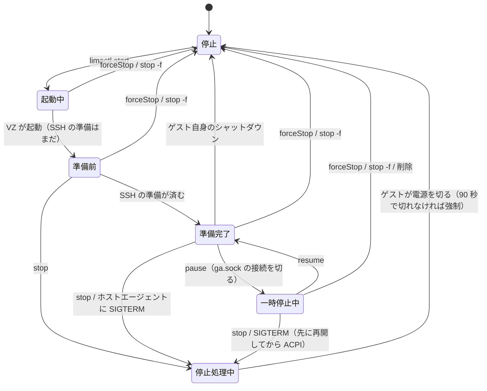

# VM の一時停止と再開をどう実装するか（検討メモ、2026-11-08）

Lima 2.3.0、macOS 27.0.1、HanaLima のドライバー（`vmType: hanalima`）で調べた。実験はドライバーの試作コード（`Prototypes/pause-resume-spike/driver-spike.patch`）と、使い捨ての VM `hanalima-e2e-pause`（Alpine 3.24）で行った。Codex に同じ問いを独立に検討させ、その結果との対照を 6 章に置く。

## 0. 用語

この文書と HanaLima では、「一時停止」と「休止」を次の意味で使う。どちらも、戻ったときのゲストのメモリの中身は止めたときのままである。違うのは、止めているあいだのゲストの RAM の中身の置き場所である。

| | 止めているあいだの RAM の中身 | Mac のメモリ | アプリの終了・Mac の再起動 |
|---|---|---|---|
| **一時停止** | VM のプロセスのメモリに載ったまま。CPU を止めるだけ | 使ったまま（1 GiB の VM なら約 1 GiB） | 越えられない（プロセスが終わると失う） |
| **休止** | Mac のファイル（B は保存ファイル、D はゲストのスワップ用ディスク）に書き出し、VM のプロセスは終える | 解放する | 越えられる |

ノート PC にたとえると、一時停止はスリープ（RAM に通電したまま）、休止はハイバネーション（RAM の中身をディスクに書いて電源を切る）に近い。

休止の実現方法として、VZ の状態保存（B）とゲストのハイバネーション（D）を調べた。B は Mac 側が、ゲストに知らせずに RAM の中身をファイルに書くので、一時停止と同じく、ゲストには時間が飛んだようにしか見えない。D はゲストの OS 自身が RAM の中身を自分のスワップに書いて電源を切るので、ゲストのカーネルの対応とスワップ用のディスクが要る。この文書で単に「休止」と書くときは、B と D のどちらにも当てはまることを指す。

## 1. 結論

- **最初に作るのは、VZ の `pause()`／`resume()` による RAM 内の一時停止**。HanaLima のドライバーの VM だけが対象で、Lima の `vz` の VM には手が出せない。5 分半止めて再開すると、SSH はすぐ戻り、ゲストの時計は Lima 2.3 の時刻同期が直した。40〜60 秒止めた回では、ポート転送とゲストエージェントも数秒で戻った。ただし、一時停止中に `limactl stop` すると止まらなくなる。ドライバーが一時停止のあいだゲストエージェントへの接続を切っておけば、2 秒で止まった（3.2）。
- **休止は 2 つの方法（B と D）があり、どちらも次の `limactl start` で Lima の起動確認に引っかかる**。Lima は起動のたびに cidata のインスタンス ID（IID）を新しくし、ゲストがその IID を `/run/lima-ssh-ready` に書くのを待つ。休止から戻ったゲストは前回の IID を持ったままなので、Lima は待ち続ける。ゲストの中で cidata を付け直して Lima の起動スクリプトをもう一度走らせると、新しい IID が書かれ、READY になった（3.5）。
  - **ゲストのハイバネーション**（RAM の中身をゲスト自身がスワップに書いて電源を切る）: Alpine で往復できた。Debian・Fedora のカーネルも対応している。**Ubuntu LTS（arm64）のカーネルは非対応**。
  - **VZ の状態保存**（`saveMachineStateTo`／`restoreMachineStateFrom`）: Alpine（1 GiB）で往復できた。ドライバーが 1.24 秒で保存して電源を切り、次の `limactl start` で 0.24 秒で復元した。ゲストは再起動しておらず、IID の手当てで READY になり、時計は時刻同期が直した。保存には Secure Enclave の鍵が要る。鍵がまだ無いうちは、Mac の画面のロック中に保存すると失敗し、最初の保存ではキーチェーンのパスワードを求めるダイアログが出た。鍵ができたあとは、ロック中でも保存と復元ができた（3.3）。
- **ゲストの suspend-to-RAM（ACPI のスリープ）は使えない**。VZ の Linux ゲストには S3 が無く s2idle だけで、s2idle に入ったゲストはネットワーク・vsock・シリアル・電源ボタンのどれでも起きなかった（3.4）。
- メモリのバルーンで一時停止中の RAM を減らす案も、VZ がホストにメモリを返さなかったので使えない（3.6）。

## 2. 候補

| 候補 | 何をするか | RAM | Mac の再起動を越えるか | ゲストの協力 |
|---|---|---|---|---|
| A. VZ の一時停止 | ドライバーが `pause()`、`resume()` | 持ったまま | 越えない | 不要 |
| B. VZ の状態保存 | 一時停止 → `saveMachineStateTo` → 電源断。次の起動で `restoreMachineStateFrom` → `resume()` | 手放す | 越える（同じ Mac に限る） | 不要（IID の件を除く） |
| C. ゲストの suspend-to-RAM | ゲストが `/sys/power/state` に `freeze` か `mem` を書く | 持ったまま | 越えない | 要る |
| D. ゲストのハイバネーション | ゲストが `disk` を書き、RAM の中身をスワップに保存して電源を切る | 手放す | 越える | 要る（スワップ、`resume=`、カーネルの対応） |
| E. その他 | ドライバーのプロセスを SIGSTOP、バルーンで RAM を絞る | — | — | — |

## 3. 実験

### 3.1 A: VZ の一時停止（約 5 分半）

ドライバーの制御ソケットに試作の `pause`／`resume` を足して試した。

- 一時停止と再開はどちらも 10 ミリ秒未満で終わる。
- 一時停止中も `limactl list` は Running のまま。Lima の状態には Running・Stopped・Broken などしかなく、一時停止を表す値はない（`pkg/limatype/lima_instance.go`）。外部ドライバーの `--inspect-status` で別の値を返す道もあるが、Lima の各コマンドは Running と比べて分岐するので、使わない。
- 一時停止中の `limactl shell` は応答しないまま待つ。
- 再開した直後から `limactl shell` が通り、`boot_id` は変わらない。
- ゲストの時計は止まっていた分だけ遅れるが、Lima 2.3 のホストエージェントが 10 秒ごとにゲストエージェントへ時刻を送り、100 ミリ秒を超えるずれを直す（`pkg/hostagent/timesync.go`、`pkg/guestagent/api/server/server.go`）。再開の直後に「was -326881ms off」として直り、その後のずれは 0 ミリ秒だった。
- 一時停止の前から開いていたポート転送も、再開後に開いたポートの転送も、再開から 1 秒以内に使えた。

### 3.2 一時停止中の `limactl stop`

一時停止中に `limactl stop` を実行すると、150 秒たっても終わらなかった。ホストエージェントは「Shutting down the host agent」まで進むが、ドライバーの Stop を呼ばない。再開すると、その 6 秒後に止まった。

Lima のホストエージェントは、ゲストエージェントへの呼び出しを `clientMu` を持ったまま行い、その呼び出しに期限を付けていない（`pkg/hostagent/hostagent.go` の `getOrCreateClient`）。止めるときは、ドライバーの Stop より先に自分の後片付け（`a.close()`）を済ませ、そこでも同じロックを取る（同ファイル 562 行付近）。一時停止したゲストへの呼び出しが返らないので、後片付けがロックを待ち続ける。これは Codex がソースから指摘し、実験で確かめた。

対策として、ドライバーは一時停止のときに `ga.sock`（ゲストエージェントへの橋渡し）を閉じ、一時停止のあいだは Lima からの接続の要求（`GuestAgentConn`）を断るようにした。これでゲストエージェントへの呼び出しはすぐに失敗し、70 秒の一時停止のあとでも `limactl stop` は 2 秒で終わった。再開したら橋渡しを開き直し、ホストエージェントは 10 秒以内につなぎ直す。

残る問題は、ドライバーの Stop が一時停止中の VM に ACPI の電源ボタンを送れず、電源を切ってしまうこと。ゲストのページキャッシュが失われるので、Stop は先に再開してから電源ボタンを送るべきである。

### 3.3 B: VZ の状態保存

ドライバーの実際の構成（virtiofs の共有、vsock、シリアル、usernet の NIC、エントロピー、バルーン。画面なし）は `validateSaveRestoreSupport()` を通った。

保存は「The virtual machine failed to save with error “permission denied”」（VZErrorDomain 11）で失敗した。保存先（VM のフォルダ、`/tmp`、`$TMPDIR`、`~/Library/Application Support`）、共有の有無、vsock の接続の有無、ad-hoc 署名の単体のプログラム（EFI とディスクだけの VM）、launchd のジョブ、アプリのバンドルのどれでも同じだった。

システムのログに原因があった。保存のとき、Virtualization の VM プロセスが Secure Enclave に鍵を作ろうとし、`SecKeyCreateRandomKey` が `errSecInteractionNotAllowed`（-25308）で失敗している。鍵の ACL はロック解除中だけ使える種類（`aku`）だった。画面は 23:06 からロックされていて（`IOConsoleLocked`、`CGSSessionScreenIsLocked`）、最初の保存の試み（23:22）より前だった。保存ファイルは「同じ Mac でしか戻せない」と Apple が説明しているのは、この鍵で暗号化するためだと考えられる。ロックが原因というのは、ここまでの状況からの推定である。

2026-11-08 の朝、ロックを解いた Mac で次のことを確かめた。

- 単体のプログラム（ad-hoc 署名）の保存は、最初の 1 回でキーチェーンのパスワードを求めるダイアログを出して止まった。ユーザーが「常に許可」を選んでからは、ダイアログなしで通った。保存ファイルは約 90 MB（メモリ 512 MiB）。許可がどの署名に結び付いたのか（このプログラムか、Virtualization の VM プロセスか）は確かめていない。後で試したドライバーの保存では、ダイアログは出なかった。
- 単体のプログラムで、ディスクだけの構成は保存 → 復元 → 再開まで通った。ネットワークの MAC を毎回ランダムにすると、復元は「invalid argument」で失敗した。復元には保存時と同じ構成（MAC を含む）が要る。Lima の MAC は固定なので、ドライバーでは問題にならない。単体のプログラムでデバイスを足した構成は、15 秒以内にゲストが自分で電源を切ることが多く（`guestDidStop`、cidata もコンソールも無いので理由は見えない）、その回は保存まで進まなかった。
- 試作のドライバー（7 章）で、Alpine の VM（`--vm-type=hanalima`、2 CPU、1 GiB、共有なし）を起動し、制御ソケットの `suspend` を送った。一時停止、保存（92 MB、1.24 秒）、電源断のあと、Lima は Stopped にした。
- 次の `limactl start` で、ドライバーは保存ファイルを 0.24 秒で復元して再開した。Lima は cidata.iso を作り直していた（新しい IID）が、復元は通った。`boot_id`、`/dev/shm` に書いた目印、`nohup` で残したプロセスはそのままだった。
- Lima は 3.5 と同じく「User session to be ready for SSH」で止まった。3.5 の手順 6 で READY になり、時刻同期がゲストの時計の 12.2 秒の遅れを直した。そのあとの `limactl stop` は 5.5 秒で終わった。

ロック中の保存の失敗は、鍵を作る段階で起きていた（`SecKeyCreateRandomKey`）。2026-11-08 の午後、朝に鍵ができて「常に許可」も選んだあとで、ロック中に試した（段階 2 の実装、使い捨ての Alpine 2 台）。

- ロックを検知してから、実行中の VM に休止を頼むと、保存（96 MiB、0.37 秒）と電源断まで通った。
- ロックの前に休止しておいた VM を `limactl start` すると、ロック中のまま 18 秒で READY になった。`boot_id`、`/dev/shm` の目印、`nohup` のプロセスはそのままだった。ロック中に保存した VM も、ロック中のまま再開できた。
- ダイアログは出なかった。

つまり、ロックが妨げるのは鍵を作ることで、できた鍵を使うことではないと考えられる。鍵がいつ作り直されるか（OS の更新、別のユーザー、キーチェーンの初期化）は確かめていない。ログイン前の自動起動での復元は、ログインしていないのでキーチェーンが開いていない点がロック中とは違い、確かめていない。

### 3.4 C: ゲストの suspend-to-RAM

Alpine の `/sys/power/state` は `freeze mem disk` を示すが、`mem_sleep` は `[s2idle]` だけで、S3（deep）は無い。時計は `rtc-efi` で、virtio のデバイスにはウェイクアップの設定が無い。

`freeze` を書くと、ゲストは止まった。その後、SSH（usernet と vsock の両方）、シリアルへの入力、VZ の `requestStop`（ACPI の電源ボタン）のどれでも起きず、60 秒後にドライバーが電源を切った。止まったゲストに対しても、3.2 と同じく `limactl stop` が終わらなかった。

画面付きの VM の USB キーボードなら起こせる可能性はあるが、それを確かめても、ホストから確実に起こせない方式は採れない。

### 3.5 D: ゲストのハイバネーション

カーネルの対応を各テンプレートで調べた。

| ゲスト | カーネル | ハイバネーション |
|---|---|---|
| Alpine 3.24 | 6.18.60-0-virt | 対応 |
| Debian 13 | 6.12.115+deb13.1-cloud-arm64 | 対応 |
| Fedora 45 | 7.2.11-300.fc45.aarch64 | 対応 |
| Ubuntu 26.04 LTS | 7.0.0-38-generic | **非対応**（`CONFIG_HIBERNATION` が無い） |

Alpine での手順と結果:

1. スワップファイルは使えなかった。Alpine のルート（ext4）はブロックが 1 KiB で、スワップの先頭がページ（4 KiB）の境界に乗らず、カーネルが「Cannot find swap device」でイメージを書けない。
2. 代わりに Lima の追加ディスク（2 GiB、raw、`format: false`）をスワップにし、Limine のカーネル引数に `resume=UUID=…` を足した。Alpine の initramfs は `resume=` を扱う。
3. ゲストで `echo disk > /sys/power/state` を実行すると、6 秒で電源が切れ、Lima は通常の停止として Stopped にした。
4. `limactl start` で、ゲストはイメージから戻った。`boot_id`、tmpfs に書いた目印、動いていたプロセスがそのまま残っていた。
5. Lima は「User session to be ready for SSH」で止まった。ゲストの `/run/lima-ssh-ready` と `/run/lima-boot-done` は前回の IID（`iid-1794063160`）で、新しい cidata は `iid-1794063192`。Lima は IID を起動のたびに作り直し（`pkg/cidata/cidata.go` の「change instance id on every boot」）、`/run/lima-ssh-ready` がその IID と一致するのを待つ（`pkg/hostagent/requirements.go`）。
6. ゲストで `/mnt/lima-cidata` を外し（古い ISO の内容がキャッシュに残っている）、cloud-init が毎回走らせる `/var/lib/cloud/scripts/per-boot/00-lima.boot.sh` をもう一度実行すると、新しい cidata の起動スクリプトが走って新しい IID が書かれ、Lima は READY になった。このとき走るのは IID を書く部分だけではなく、起動時の処理（ユーザーのプロビジョニングを含む）すべてである。Lima はもともと起動のたびにこれらを走らせるので、どれも繰り返しに耐える前提になっている。ゲストエージェントもつながり、時計も合っていた。起動スクリプトの失敗は、手順 2 のスワップ用ディスクを Lima がマウントしようとした `05-lima-disks.sh` だけだった。

IID を書き換えて起動したことにする方法は採らない。起動スクリプトが実際には走っていない状態を完了として扱うことになるためで、この点は Codex の意見と同じ。手順 6 は起動スクリプトを実際に走らせるので、普通の起動と同じ状態になる。

### 3.6 E: その他

- **バルーン**: ゲストで 600 MB を使って解放したあと、バルーンの目標を 256 MiB にしても、VM プロセスの物理フットプリントは 1028 MB のまま変わらなかった（RSS はむしろ 924 MB から 1150 MB に増えた）。一時停止の前に RAM を絞る用途には使えない。
- **ドライバーのプロセスを SIGSTOP する**: ホストエージェント側の転送まで止まり、VZ の状態も分からなくなるので採らない（Codex も同じ判断）。

## 4. 実装案

### 段階 1: 一時停止（A）

2026-11-08 にブランチ `feature/pause` で実装した（下の方針どおり。E2E は `DriverPauseEndToEndTests`、Alpine と Ubuntu LTS で通過）。

- 対象は `vmType: hanalima` の VM だけ。Lima の `vz` の VM には一時停止の手段が無い（内部ドライバーが VZ を持ち、Lima のドライバーのインターフェースに一時停止が無い）。
- 経路は制御ソケット `hanalima-ctl.sock` に `pause`・`resume` を足す。Lima の gRPC には足せない。
- ドライバーは、一時停止のときに `ga.sock` の既存の接続を切り、一時停止中に来た接続はゲストへつながずにすぐ閉じる（3.2）。Lima の呼び出しはその場で失敗するので、`limactl stop` が止まらない。`GuestAgentConn` そのものを断る形（最初の実装）だと、Lima が断られるたびに Error のログを書く（約 2 秒ごと）ため、こちらにした。それでも Lima の gRPC は約 1.4 秒ごとにつなぎ直し、そのたびに Info のログ（「Getting guest agent connection」）を書くので、一時停止中の `ha.stderr.log` は 1 分に約 55 行増える（断る形では約 73 行）。つなぎ直しの間隔を広げるには `GuestAgentConn` を遅らせるしかなく、その分だけ `limactl stop` も遅れるので、そこまではしない。
- Stop（`limactl stop`、アプリの停止、制御ソケットの `stop`）は、一時停止中なら先に再開してから ACPI の電源ボタンを送る。`forceStop` はそのまま電源を切る。
- 起動中（READY の前）は一時停止を断る。Lima の起動確認は SSH の再試行に回数の上限があり、重なると `limactl start` が失敗しうるため（Codex の指摘。試してはいない）。
- 一時停止・再開・停止を 1 つずつ処理する。いまの `busy` に、一時停止と再開も含める。
- アプリは、Lima の Running とは別に制御ソケットの `status` の `state`（`paused` など）を見て、サイドバーと VM の画面に「一時停止中」と出す。一時停止中は、コンソール、今すぐ実行、Ansible を使えなくする（どれも応答しないまま待つため）。画面とサムネイルは止まった時点の絵のままになるので、一時停止中であることを添える。
- アプリを終了しても一時停止はそのまま残る（ドライバーのプロセスが VM を持つ）。次の起動で `status` から一時停止中と分かる。
- 外付けディスクの移動、複製、スナップショット、設定の編集は、Lima から見て Running なので、いまの判定のまま断られる。
- E2E: 一時停止中に `limactl list` が Running、`boot_id` が変わらない、再開後に SSH とポート転送が戻る、時計が 20 秒以内に合う、一時停止中の `limactl stop` が 10 秒以内に終わってゲストが ACPI で止まる（電源断ではない）こと。Alpine と Ubuntu LTS（SSH が vsock の場合と usernet の場合）。

#### 状態遷移と確かめた結果

ドライバーが持つ、VM 1 台の状態は次のとおり。アプリは別に「一時停止中」の印を持ち、自分の操作の結果と、5 秒ごとの `status` の問い合わせで更新する（`pausing`・`resuming` も一時停止中として扱う。問い合わせに答えがなければ前の印を保つ）。

| 遷移 | 結果 | 確かめ方 |
|---|---|---|
| 準備完了 → 一時停止 → 再開 | 再起動せず、時計も合う | E2E（Alpine・Ubuntu LTS） |
| 一時停止中に `limactl stop` | 再開してから ACPI で停止（3〜5 秒） | E2E |
| 一時停止中に `limactl stop -f`・削除 | ドライバーは約 1 秒で終わり、残らない | 実機 |
| 一時停止中にホストエージェントへ SIGTERM（ログアウト・シャットダウンで launchd が送る） | 再開してから ACPI で停止（3 秒） | 実機 |
| 一時停止中にアプリを終了して起動し直す | 「一時停止中」がそのまま出る | 画面の書き出し |
| 準備前に pause | 断る（`sshSetUp`） | コード |
| 二重の pause、一時停止していない VM への resume | 断る | E2E とコード |
| 停止処理中の pause・resume | 断る（`stopping`） | コード |
| pause の処理中に stop | 処理の完了を 10 秒まで待ってから再開する | コード |
| 再開に失敗したまま stop | ACPI を受け付けないので強制停止 | コード |
| 一時停止中の再起動 | 上の stop と同じ経路のあと起動 | コード（E2E はしていない） |
| 一時停止中の複製・スナップショット・設定の変更・ディスクの移動・救出起動 | Lima から見て Running なので、これまでどおり断る | コード |
| hosted モード（救出起動・ISO インストール）での pause | SSH の準備が無いので断る | コード |
| 一時停止中に `status` の問い合わせが失敗 | 前の印を保つ | コード |
| 一時停止中のゲストエージェントへの接続 | すぐ閉じる。Lima は Error のログを書かない | E2E |
| Mac の画面のロック中の pause・resume | 通る（VZ の状態保存と違い、Secure Enclave の鍵は要らない） | 実機 |
| 60 秒以上の一時停止からの再開 | NIC のリンクを 1 秒落として戻し、ゲストに DHCP のリースを確かめさせる（下の「DHCP のリース」） | E2E（Alpine・Ubuntu LTS） |

残っているもの:

- 一時停止中の Mac のスリープは、後回しにした（2026-11-08 ユーザー判断。開発機は Mac mini で、スリープの代わりに画面のロックしか使っていない）。ロック中の一時停止と再開は通った。
- ホストエージェントが SIGKILL などで消えると、ドライバーは一時停止した VM を持ったまま残り、Lima は Broken と出す。`limactl stop -f` で片付く。一時停止に限った話ではない。
- 一時停止中は、ターミナルの `limactl shell` や開いている SSH が何も出さずに止まる。アプリのコンソールタブは「一時停止中」と出すが、アプリの外には知らせようがない。

#### DHCP のリース

一時停止のあいだ、ゲストの時計は進まない。60 秒以上止めた Alpine の `/proc/uptime` は、再開の前後で 0.1 秒も進んでいなかった（壁時計は Lima の時刻同期が直すが、単調時計はそのまま）。DHCP のクライアントは単調時計でリースの期限を数えるので、再開したゲストは止めたときの残り時間のままリースを信じ続ける。

サーバーの側はリースを実際の時間で数える。netd のゲスト専用ネットワークは、期限が切れたアドレスを捨てて、次に求めた VM に一番小さい空きアドレスとして貸す（`GuestOnlyDHCPTests` の `expiryDeclineAndInform` が、その再利用を確かめている）。リースの長さは netd が 1 日、vmnet の bootpd が約 1 時間（`/var/db/dhcpd_leases` の期限とファイルの更新時刻の差、約 3500 秒）、Lima の usernet が 3600 秒（Alpine の dhcpcd が表示した値）。そのため、リースの残りより長く止めると、そのあいだに別の VM が同じアドレスを受け取り、再開した VM は自分の期限が来るまで同じアドレスを使い続けうる。usernet は VM ごとに別のプロセスなので重ならないが、Lima の共有の user-v2 では重なりうる。

そこでドライバーは、60 秒以上の一時停止から再開したとき、すべての NIC のリンクを 1 秒落として戻す（VZ の `attachment` を nil にしてから戻す）。リンクが戻ると、ゲストの DHCP のクライアントはリースを確かめ直す。

- Alpine（dhcpcd）は「carrier lost」で経路を消し、「rebinding lease」で同じアドレスを求め、アドレスの重複の確認（約 4 秒）のあと同じアドレスを受け取った。経路の無い時間は約 5 秒。usernet の SSH で開いていたシェルは切れなかった。
- Ubuntu LTS（systemd-networkd）は「DHCP lease lost」のあと、すぐに同じアドレスを受け取った。

アドレスが別の VM に貸されていれば、サーバーは NAK を返し（netd はそう実装している）、ゲストは新しいアドレスを受け取るはずである。実際に重なる状況（リースの期限切れと別の VM の要求）は作っていない。netd のリースは 1 日で、短くする設定が無いため。60 秒未満の一時停止でリンクを落とさないのは、Alpine の約 5 秒の途切れを避けるためで、そのあいだにリースが切れる組み合わせは残る（リースの残りが 60 秒未満のときに止めた場合）。

### 段階 2: 休止（B を先に作る。D は後で検討）

B は 2026-11-08 にブランチ `feature/hibernate` で実装した。E2E は `DriverHibernateEndToEndTests`。

#### B（VZ の状態保存）の実装

- 経路は制御ソケットの `hibernate`。ドライバーは VM を一時停止し、`saveMachineStateTo` で RAM とデバイスの状態を VM のフォルダの `hanalima-state.vzsave` に書き、電源を切る。Lima からは普通の停止に見え、Stopped になる。対象は一時停止と同じく `vmType: hanalima` の VM だけで、起動の完了前は断る。一時停止中の VM も休止できる。
- 電源を切ったあと、VM の様子を `hanalima-state.json` に記録する。中身は `vz-identifier`、VZ から見た構成（CPU、メモリ、共有、NIC、追加ディスクなど）、NIC 0 の MAC、`disk`・`vz-efi`・追加ディスクの inode・大きさ・更新時刻。保存ファイルと記録がそろったときだけ「休止中」とみなす。
- 次の `limactl start` で、ドライバーは何かに触る前に記録と今の VM を比べる。同じなら、起動する代わりに `restoreMachineStateFrom` で戻して再開する。保存ファイルは戻す間だけ名前を変え、再開できたら消す（一度だけ使う）。戻せなかったら名前を戻して残す。
- 記録と違えば、Start を断る。保存ファイルも残す。普通に起動するとゲストのメモリの内容を黙って捨てることになり、戻すと古いメモリと変わったディスクを組み合わせることになるからである。設定を元に戻せば再開できる（E2E で確認）。アプリは、起動に失敗したときに保存ファイルが残っていれば「保存した状態を捨てて起動」するかを尋ねる。ターミナルでは、Lima のエラーの先（`ha.stderr.log`）にドライバーの理由と保存ファイルのパスが出る。
- 保存ファイルは、当初の案（VM のフォルダの外）ではなく VM のフォルダに置いた。`limactl delete` で一緒に消え、持ち主のいないデータにならないからである。`limactl clone` は保存ファイルも写すが、複製の `vz-identifier` は新しくなるので、ドライバーは「別の VM から写った状態」として捨て、普通に起動する。ディスクの inode も変わるので、識別子だけに頼ってはいない。
- `limactl rename` した VM も再開できない。Lima 2.3 の rename は `vz-identifier` を作り直し、NIC 0 の MAC も VM のフォルダのパスから作るので変わる。VZ は構成の違う VM には戻せない（MAC を変えた構成で戻すと失敗することは 3.3 で確かめた）うえ、名前を戻しても識別子は戻らない。そのため、ドライバーは複製と同じく保存した状態を捨てて普通に起動する（E2E で確認）。記録の MAC は、識別子が同じなのに MAC が違う場合の備えとして比べる。アプリには改名の操作が無い。
- 戻したあとの IID の手当て（3.5 の手順 6）は、ゲストの中にサービスを置かず、ドライバーが行う。SSH の準備（`AdditionalSetupForSSH`）が済んだら、Lima の `ssh.config`（hostagent が Start より前に書く）で SSH し、`/mnt/lima-cidata` を外し、ブロックデバイスのキャッシュを捨て、Lima の `00-lima.boot.sh` を裏で走らせる。ゲストの協力が要らないという B の利点を保つためで、ゲストの中のサービスには「戻った」ことを知るきっかけも無い。SSH は Lima の制御ソケットを使わない（`ControlMaster=no`）。ドライバーの SSH が Lima の多重化の親になって残らないようにするためである。
- 戻したあとは、一時停止から 60 秒以上たったときと同じく、NIC のリンクを 1 秒落として戻す。usernet のプロセスは新しくなっていて、ゲストの DHCP のリースは前の usernet のものだからである。
- 保存の前に、保存先のボリュームに「メモリの大きさ＋1 GiB」の空きがあるかを確かめる。保存に失敗したら、VM を再開して元どおり動かす。保存の拒否（VZErrorDomain 11）は、アプリが「ロックを解除してから」と案内する。鍵がまだ無いうちに画面のロック中に保存すると、こうなる（3.3）。
- アプリ: 休止中の VM は「休止中」と出し（藍色の印）、起動ボタンは「再開」になる。帯とメニューから「保存した状態を捨てる」ことができる。休止中は、複製、救出起動、ディスクの移動、スナップショットの作成・戻す・削除を断る。どれもディスクを書き換えるか、休止中のディスクを写してしまう。設定の編集は止めず、次の起動で違いが分かったときに尋ねる。

#### 確かめた結果（2026-11-08、Mac のロック解除中）

| | Alpine | Ubuntu LTS |
|---|---|---|
| 休止（メモリ 2 GiB） | 0.4 秒、100 MiB | 0.6 秒、864 MiB |
| 次の `limactl start`（READY まで） | 19 秒 | 7 秒 |
| 戻す・再開 | 0.3 秒 | 0.9 秒 |

- どちらも `boot_id`、`/dev/shm` のファイル、`nohup` で残したプロセスがそのままで、`/run/lima-boot-done` は新しい IID になった。ゲストの時計は Lima の時刻同期で合った。
- Ubuntu でも、cidata を外してキャッシュを捨てれば新しい ISO の内容が読めた（8 章で未確認としていた点）。
- 作り直したドライバー（署名が変わる）でも、キーチェーンのダイアログは出なかった。
- 休止中にメモリを変えると、Start は「the VM's settings changed since it was hibernated」で断られ、保存ファイルは残った。メモリを戻すと、元の状態から再開した。
- `limactl clone` の複製と、休止中に `limactl rename` した VM は、保存した状態を捨てて普通に起動した。

#### D（ゲストのハイバネーション）を作るなら（未着手）

- スワップ用の追加ディスクを HanaLima が作って付け、`resume=` をカーネル引数に足す例を用意する。カーネル引数の場所はゲストで違う（Alpine は Limine、Debian・Fedora は GRUB）。
- ハイバネーションは `limactl shell <名前> sudo hanalima-hibernate`（`echo disk > /sys/power/state` と、戻ってからの IID の手当てを 1 つにしたもの）で行う。電源が切れると Lima は Stopped にするので、HanaLima 以外の手順は要らない。
- ホストからは、スワップ用ディスクの先頭ページの署名（休止中は `S1SUSPEND`、通常は `SWAPSPACE2`。Linux のスワップの形式からの推測で、要確認）で「ハイバネーション中」と分かるはずである。表示と、次の操作の判断に使える。
- ハイバネーション中に、ディスクのスナップショットを戻す、設定を変える、カーネルを更新するなどをすると、戻ったゲストのメモリとディスクが食い違い、ファイルシステムを壊しうる。HanaLima の操作（スナップショットを戻す、ディスクの移動、複製）は、ハイバネーション中なら署名を消してハイバネーションを捨てるか、断る。`limactl` を直接使った操作には手が届かない。
- Ubuntu LTS では使えない。

## 5. 決めたこと（2026-11-08、ユーザー判断）

1. 段階 1（一時停止）から作る。
2. 休止は B（VZ の状態保存）を先に作る。
3. 一時停止中の VM に `limactl stop` が来たら、ゲストを再開してから ACPI で正常に止める。電源は切らない。
4. Lima の `vz` の VM には一時停止を求めない。Lima 本体への提案はしない。

## 6. Codex の検討との対照

Codex（read-only、Lima 2.3.0 のソースを参照）に、私の結論を渡さずに同じ問いを検討させた。

**一致した点**:

- 最初は RAM 内の一時停止を作り、状態保存は後に分ける。
- 一時停止中の外部の `limactl stop` が、ゲストエージェントへの期限の無い呼び出しで詰まる。Codex はソースから予測し、私が実験で確かめた。対策（一時停止中は `ga.sock` を切る）も Codex の第一案と同じ。
- 状態保存から戻すと、Lima の IID の確認で止まる。完了の印を書き換えて起動したことにはしない。
- 状態保存を戻せなかったとき、黙って普通に起動しない。保存した状態は一度だけ使う。
- 一時停止中の停止は「再開してから ACPI」、強制停止はそのまま電源断。
- SIGSTOP は採らない。Lima の `vz` の VM には手が出せない。

**違った点**:

- Codex は「状態保存を戻すには Lima 本体に復帰用の起動経路が要る」とした。私は、ゲストの中で cidata を付け直して Lima の起動スクリプトを走らせれば、Lima を変えずに READY になることを実験で示した（3.5）。Lima 本体の変更よりこちらを先に考える。
- Codex は保存ファイルの互換性（構成、OS の更新）を主な危険とした。実際に最初に当たったのは、Mac のロック中に鍵を作れないことだった（3.3）。構成の違いは、MAC がランダムな構成で復元が失敗したことで確かめられた。
- Codex はゲスト側の方式（C、D）を検討していない（問いがそこを含んでいなかった）。D は Lima を変えずに RAM を手放せる、いま実際に動いた唯一の方法である。
- Codex は一時停止の要求を「操作 ID を返して `status` で完了を見る」形にすることを勧めた。一時停止と再開は 10 ミリ秒未満で終わるので段階 1 では同期で足り、状態保存（時間がかかる）を作るときに考える。

## 7. 試作コードの扱い

ドライバーの試作コード（制御ソケットの `pause`・`resume`・`suspend`・`probeSave`・`trim`・`untrim` と、Start での復元）は実験用で、そのまま取り込まない。`Prototypes/pause-resume-spike/driver-spike.patch` に置き、`git stash` にも同じものを残した。Codex のレビューで次の点を指摘され、どれも本実装の設計（4 章）で扱う。

- 一時停止中の Stop が、再開せずに電源を切る（3.2）。
- `suspend` の保存が失敗すると、VM は一時停止のまま残り、`ga.sock` も閉じない。
- 復元に失敗すると保存ファイルを消してしまう。本実装では、成功して使い終えるか、ユーザーが捨てると決めるまで残す。
- 保存後にディスクのスナップショットを戻しても、次の Start が古い RAM を復元する。
- 復元後の IID の手当てが無い（3.5）。

## 8. 残りの実験

- B の復元が、ログイン前の自動起動でできるか（ロック中の保存と復元は、鍵ができたあとならできた。3.3）。
- B の保存のときにキーチェーンのダイアログが出る条件。ドライバーを作り直しても出なかった（段階 2）が、別の Mac や別のユーザーでの初回は確かめていない。
- B をメモリの大きな VM で（保存ファイルの大きさと所要時間）。Ubuntu LTS の 2 GiB は段階 2 で確かめた。
- 画面付きの構成が `validateSaveRestoreSupport` を通るか（今回は画面なしの構成だけを調べた）。
- D を Debian・Fedora で（GRUB の `resume=`、initramfs の対応）。
- 一時停止をリースより長く続け、そのあいだに別の VM が同じアドレスを受け取る状況での、再開後の NAK と付け替え（netd のリースを短くできないので作っていない）。ブリッジの LAN 側の DHCP サーバーでの振る舞い。
- Mac のスリープとの重なり（一時停止中の VM、休止中の VM）。後回し（開発機の Mac mini はロックだけで使っている）。
- 画面付きの VM での一時停止（ウインドウ、スクリーンショット）。
